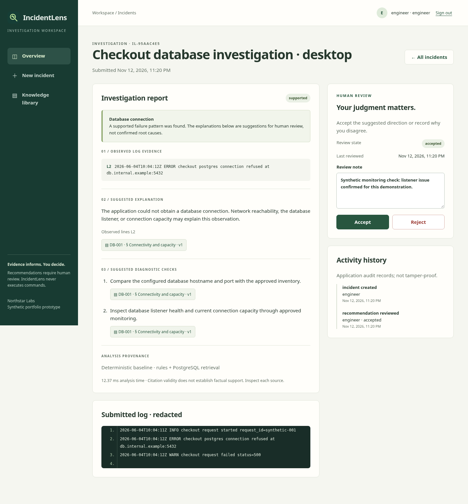
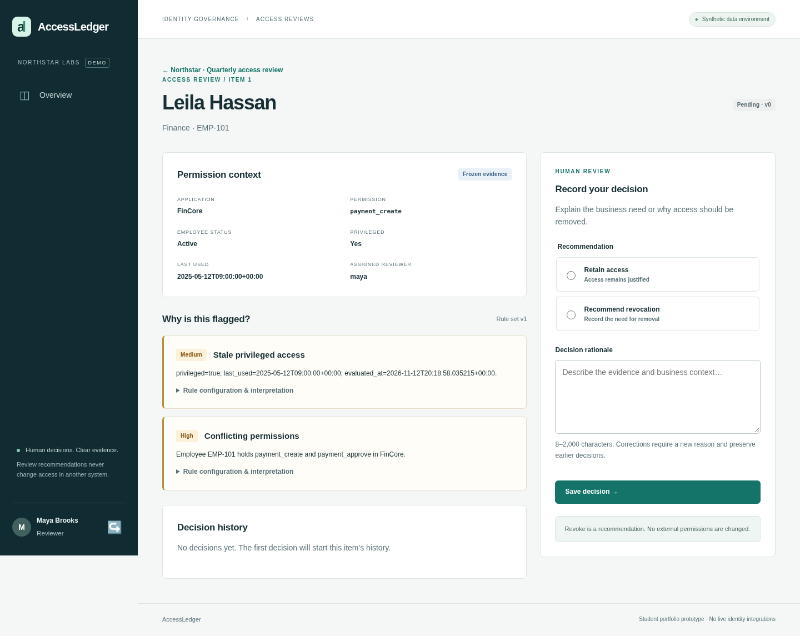
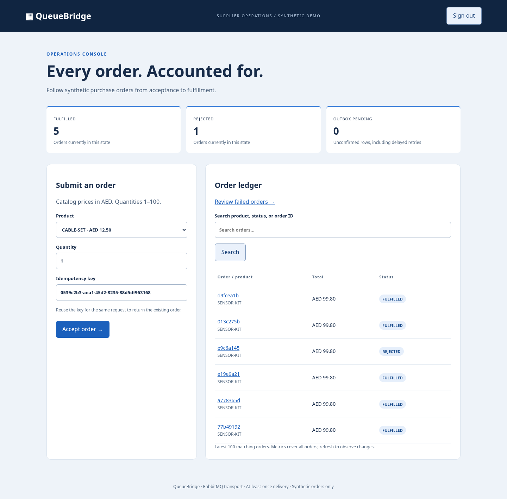
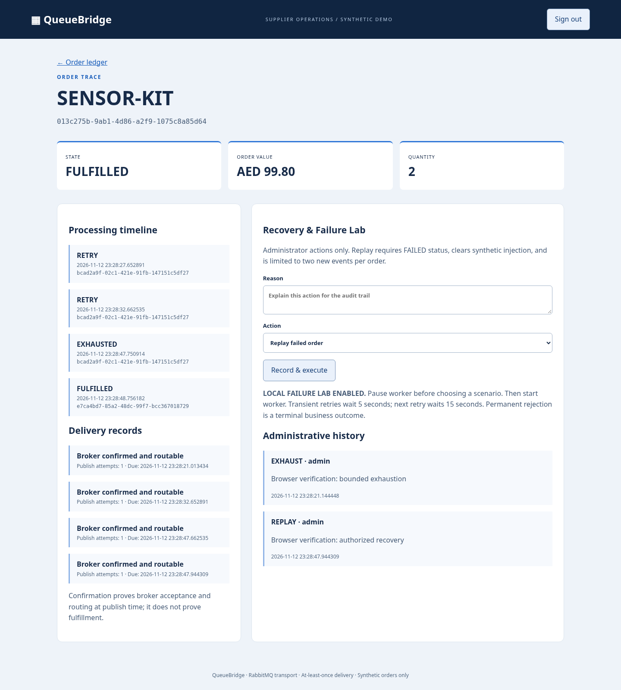

**Computer Science student · Building toward a career in software engineering**

I'm studying Computer Science at Canadian University Dubai, with career interests in artificial intelligence and cloud computing. I want to build software that solves useful problems and is clear enough for other people to understand, test, and maintain.

## Featured Projects

[IncidentLens](#incidentlens) · [AccessLedger](#accessledger) · [QueueBridge](#queuebridge)

Three student portfolio applications using **synthetic data**. Screenshots show the real interfaces and recorded demo activity; these projects are not production services.

### [IncidentLens](https://github.com/mohamedbreed192-droid/incidentlens)

Investigate application log failures with **inspectable evidence**. IncidentLens extracts log-line signals, retrieves permitted runbook sections, and presents a suggested investigation direction for human review.

**Technology:** Python · FastAPI · PostgreSQL · SQLAlchemy · Alembic · HTML/CSS/JavaScript

- Filters runbook access in the retrieval query before context reaches analysis.
- Links suggestions to log lines and source versions; withholds reports when their sources change or become inaccessible.
- Records accept/reject decisions and audit events; abstains on unsupported or conflicting signals.

**Scope:** Synthetic logs and runbooks; deterministic baseline. No commands or infrastructure changes.

[Source code](https://github.com/mohamedbreed192-droid/incidentlens) · [Local setup](https://github.com/mohamedbreed192-droid/incidentlens#start-the-local-demo) · [Evaluation & limitations](https://github.com/mohamedbreed192-droid/incidentlens/blob/main/docs/EVALUATION.md)

Analysis limits & model integration

The baseline covers three failure categories with English lexical rules. Negation and quoted examples are known failure modes; valid citations do not prove an explanation is true. An optional OpenAI adapter is implemented, but provider tests use mocks and live model behavior has not been verified. There is no implemented IBM integration.

---

### [AccessLedger](https://github.com/mohamedbreed192-droid/accessledger)

Review employee access with **explainable findings and accountable decisions**. AccessLedger validates CSV imports, snapshots review campaigns, and lets assigned reviewers record retain/revoke recommendations with a rationale.

**Technology:** Python · FastAPI · PostgreSQL · SQLAlchemy · Alembic · Jinja2

- Requires explicit confirmation after row-level CSV validation; snapshots grants, assignments, rule output, and evaluation time.
- Restricts decisions to assigned reviewers and rejects stale updates with version checks.
- Preserves previous decisions in audit events; exports decisions and audit history as formula-protected CSV files.

**Scope:** Fictional employees and grants. Revocation records a recommendation; it never changes external permissions. Audit history is not tamper-proof or a compliance certification.

[Source code](https://github.com/mohamedbreed192-droid/accessledger) · [Local setup](https://github.com/mohamedbreed192-droid/accessledger#run-locally) · [Architecture & decisions](https://github.com/mohamedbreed192-droid/accessledger/blob/main/docs/architecture.md)

---

### [QueueBridge](https://github.com/mohamedbreed192-droid/queuebridge)

Follow orders through **asynchronous processing and recovery**. QueueBridge accepts synthetic supplier orders, persists order and outbox records in one transaction, and processes RabbitMQ deliveries with a database-backed inbox.

**Technology:** Java 21 · Spring Boot · PostgreSQL · RabbitMQ · Flyway · Thymeleaf

- Reuses an order for the same idempotency key and content; rejects conflicting submissions.
- Checks publisher confirms and routing; uses inbox records to handle duplicate deliveries.
- Implements delayed retries, dead letters, and bounded administrator replay with recorded reasons.

**Scope:** Local learning project with at-least-once delivery and synthetic orders. No payments, external fulfillment, or IBM MQ integration.

[Source code](https://github.com/mohamedbreed192-droid/queuebridge) · [Local setup](https://github.com/mohamedbreed192-droid/queuebridge#run-locally) · [Architecture & crash windows](https://github.com/mohamedbreed192-droid/queuebridge/blob/main/docs/architecture.md)

Real recovery timeline & delivery limits

Broker confirmation establishes acceptance and routing at publish time; it does not prove fulfillment. Delivery can repeat across crash windows. The local Failure Lab uses explicit synthetic scenarios; it is not evidence of production resilience.

[Failure and recovery walkthrough](https://github.com/mohamedbreed192-droid/queuebridge/blob/main/docs/demo.md)

## Technical toolkit

My public work in [IncidentLens](https://github.com/mohamedbreed192-droid/incidentlens) uses:

| Area | Technologies used in the project |
| --- | --- |
| Programming & web | Python, JavaScript, HTML, CSS |
| Backend development | FastAPI, Pydantic, SQLAlchemy |
| Data | PostgreSQL, full-text search, Alembic migrations |
| Development & verification | Git, Docker Compose, pytest, Ruff, Playwright, GitHub Actions |

My existing academic toolkit also includes **C++, Java, Linux, and Bash scripting**. AI and cloud computing are areas I want to explore further.

## Current direction

Through my Computer Science studies, I'm continuing to develop my programming fundamentals, data structures, and algorithms. My goal is to connect those foundations to practical software with clear design decisions, useful documentation, and reproducible checks.

Software engineering is my career direction; AI and cloud computing are longer-term interests.

## Connect

[GitHub](https://github.com/mohamedbreed192-droid) · [Email](mailto:mohamedbreed192@gmail.com)
