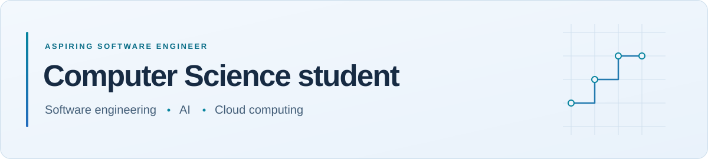

<picture>
  <source media="(max-width: 600px) and (prefers-color-scheme: dark)" srcset="./assets/header-mobile-dark.svg">
  <source media="(max-width: 600px) and (prefers-color-scheme: light)" srcset="./assets/header-mobile-light.svg">
  <source media="(prefers-color-scheme: dark)" srcset="./assets/header-dark.svg">
  
</picture>

 

  <a href="#profile-overview">Overview</a> &nbsp;·&nbsp;
  <a href="#technical-toolkit">Toolkit</a> &nbsp;·&nbsp;
  <a href="#current-direction">Direction</a> &nbsp;·&nbsp;
  <a href="#connect">Connect</a>

## Profile overview

I'm **Mohamed Said**, a Computer Science student at [Canadian University Dubai](https://www.cud.ac.ae/programs/undergraduate/engineering-applied-science-and-technology/bachelor-of-science-in-computer-science). I'm preparing for a career in software engineering, with interests in artificial intelligence and cloud computing.

I want to understand the problem behind the code, make clear design choices, and build software that other people can read and maintain.

## Technical toolkit

Technologies I've used:

- **Programming** — Python · C++ · Java · JavaScript
- **Web** — HTML
- **Systems & scripting** — Linux · Bash scripting

My academic background includes programming fundamentals, data structures, and algorithms. I'm continuing to develop these skills through my Computer Science studies.

## Selected work

**[IncidentLens](https://github.com/mohamedbreed192-droid/incidentlens)** — A student portfolio prototype for investigating synthetic application logs with cited runbooks, permission-filtered PostgreSQL retrieval, and human review with audit history.

Built with FastAPI and PostgreSQL, with Docker setup, automated tests, and published evaluation results. It works without a model; the optional model-provider adapter is mock-tested.

[Explore the screenshots, setup, and evaluation](https://github.com/mohamedbreed192-droid/incidentlens#readme).

## Current direction

- **Foundations** — Continue my Computer Science studies and strengthen my understanding of how software works.
- **Engineering** — Work toward solutions with clear design decisions, useful documentation, and reproducible checks.
- **Exploration** — Learn more about AI and cloud computing as areas of career interest.

<strong>Background & collaboration</strong>

I've worked in sales, organized university events, and volunteered with the Emirates Red Crescent. These experiences have helped me communicate with different people, coordinate work, and pay attention to what others need.

I speak Arabic and English.

<!--
MAINTAINER NOTES — not displayed on the profile.
The toolkit contains only owner-confirmed technologies. AI and cloud are interests,
not demonstrated skills. Add specific learning priorities only when confirmed.

Future selected-work structure: activate only for actual public repositories.

## Selected work

<strong>Real project name</strong>

State the problem, implemented behavior, design choices, and limitations.
Link to the real source repository and its setup and verification instructions.

Keep at most three featured entries. No fictional projects, empty promotional
cards, activity counts, or programming-language percentages are included.
-->

## Connect

[GitHub](https://github.com/mohamedbreed192-droid) &nbsp;·&nbsp; [Email](mailto:mohamedbreed192@gmail.com)
